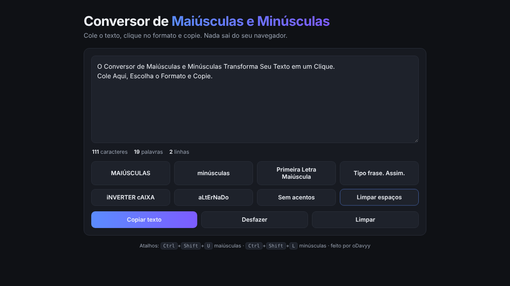

# 🔠 Conversor de Maiúsculas e Minúsculas

Ferramenta simples pra converter texto em vários formatos com um clique. Roda 100% no navegador, nada é enviado pra internet.

## Formatos
| Botão | Exemplo |
|---|---|
| MAIÚSCULAS | `OLÁ MUNDO` |
| minúsculas | `olá mundo` |
| Primeira Letra Maiúscula | `A Casa da Maria` (mantém "da", "de", "e"... minúsculos) |
| Tipo frase | `Olá mundo. Tudo bem?` |
| iNVERTER cAIXA | `oLÁ mUNDO` |
| aLtErNaDo | `oLá MuNdO` |
| Sem acentos | `ola mundo` |
| Limpar espaços | tira espaços duplos e linhas vazias sobrando |

Também tem: contador de caracteres/palavras/linhas, **Copiar**, **Desfazer** e atalhos `Ctrl+Shift+U` (maiúsculas) e `Ctrl+Shift+L` (minúsculas).

## Como usar
Abra o `index.html` no navegador. Não precisa instalar nada.

---
Feito por **oDavyy**
